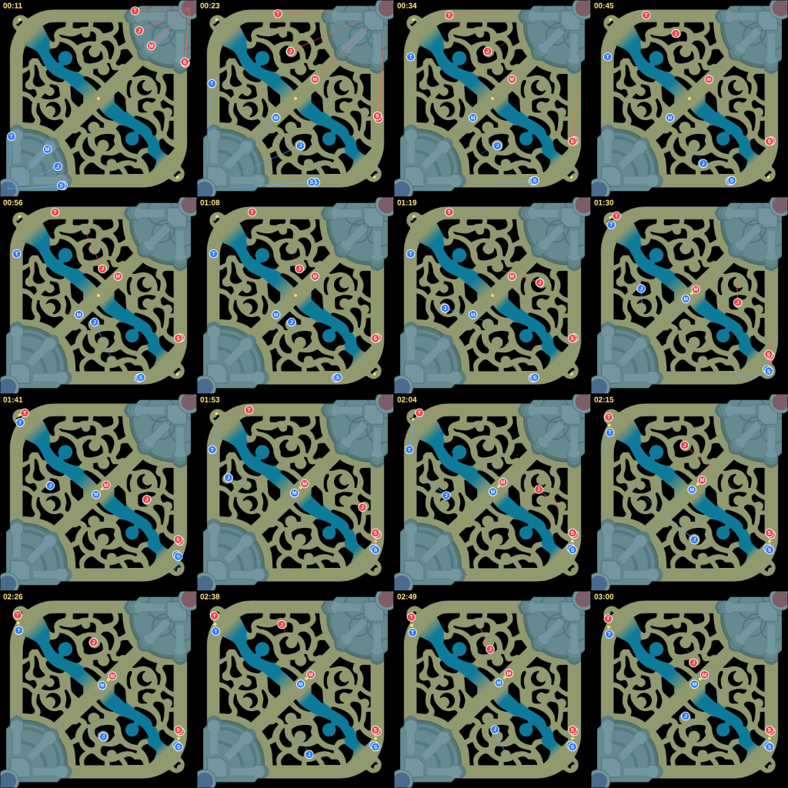
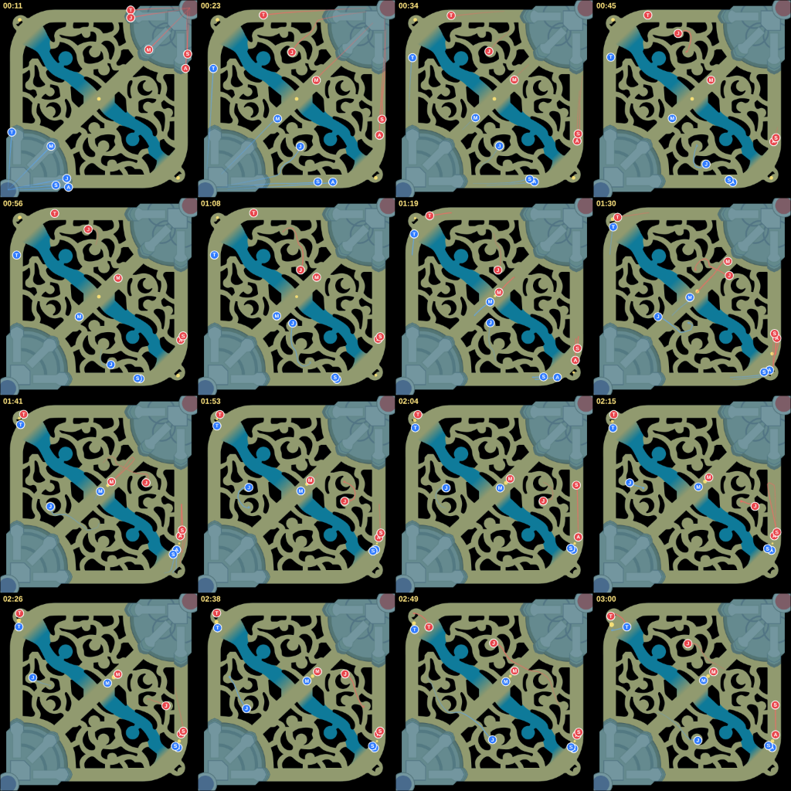
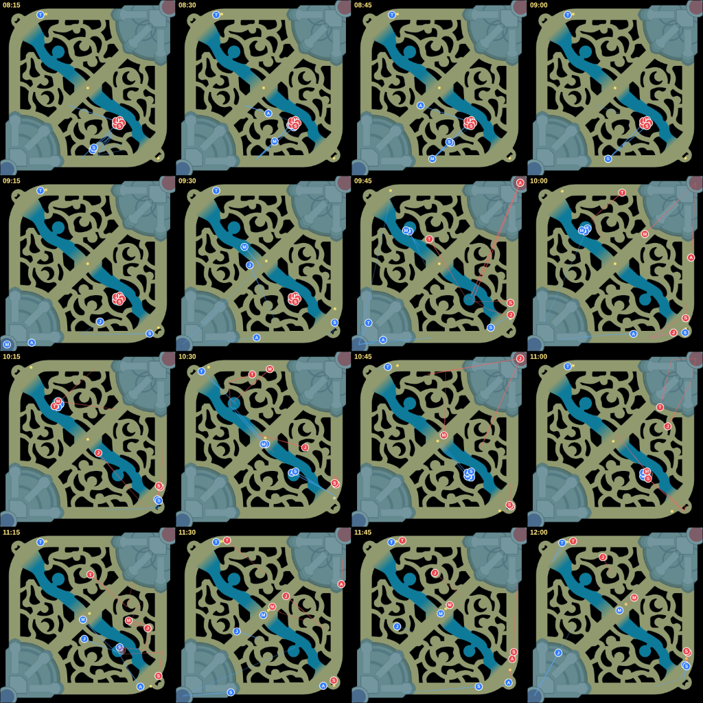
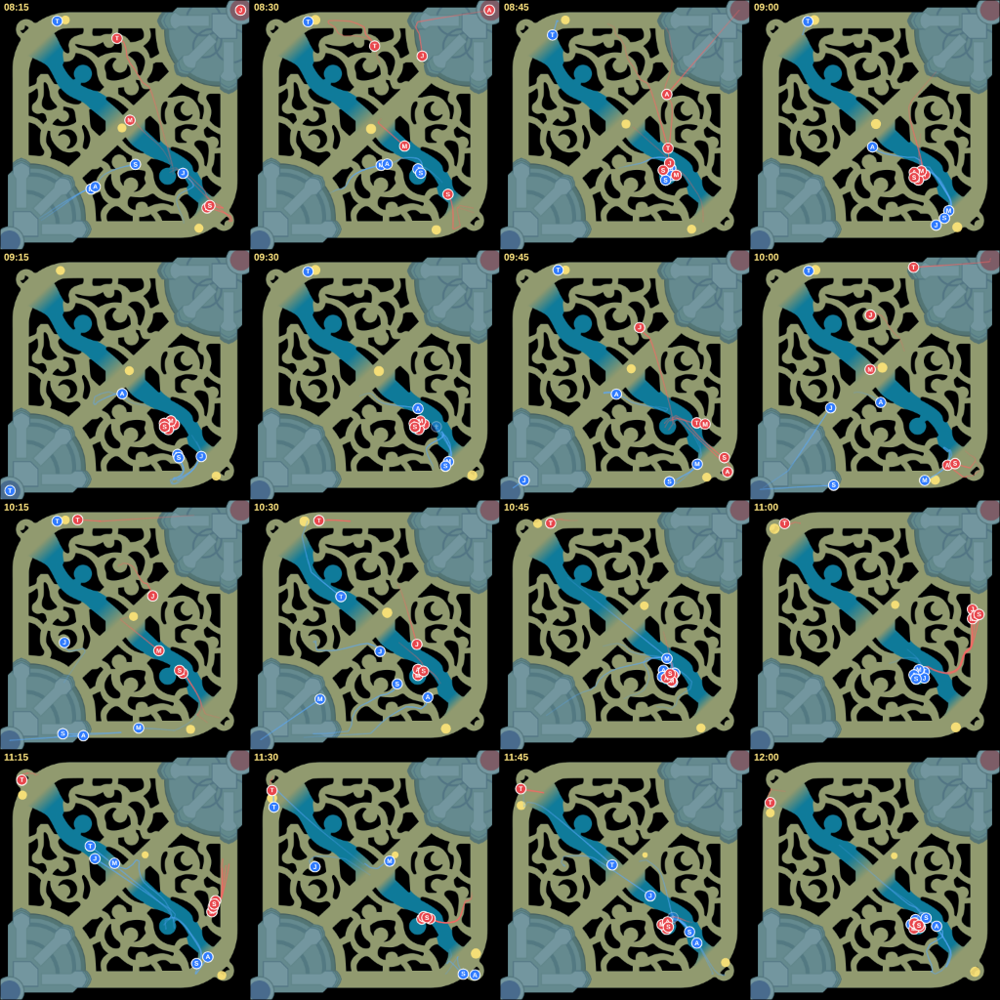
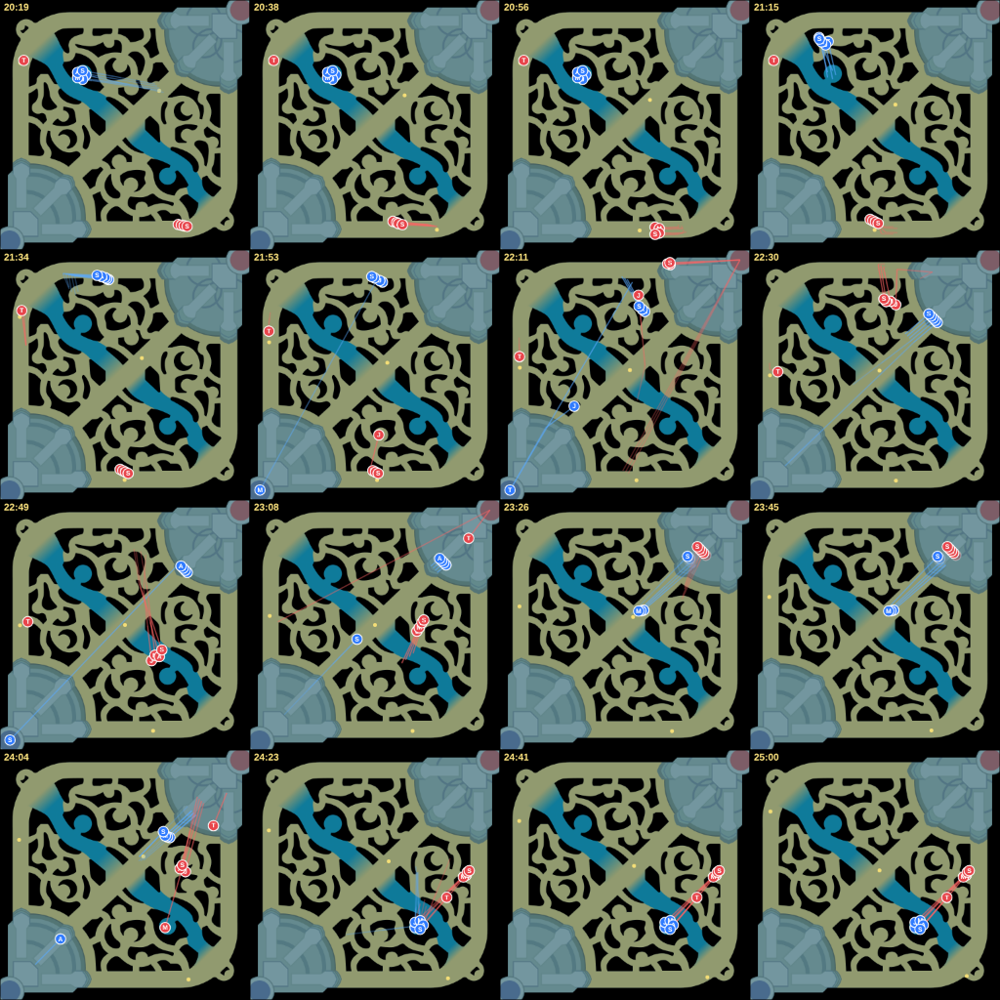
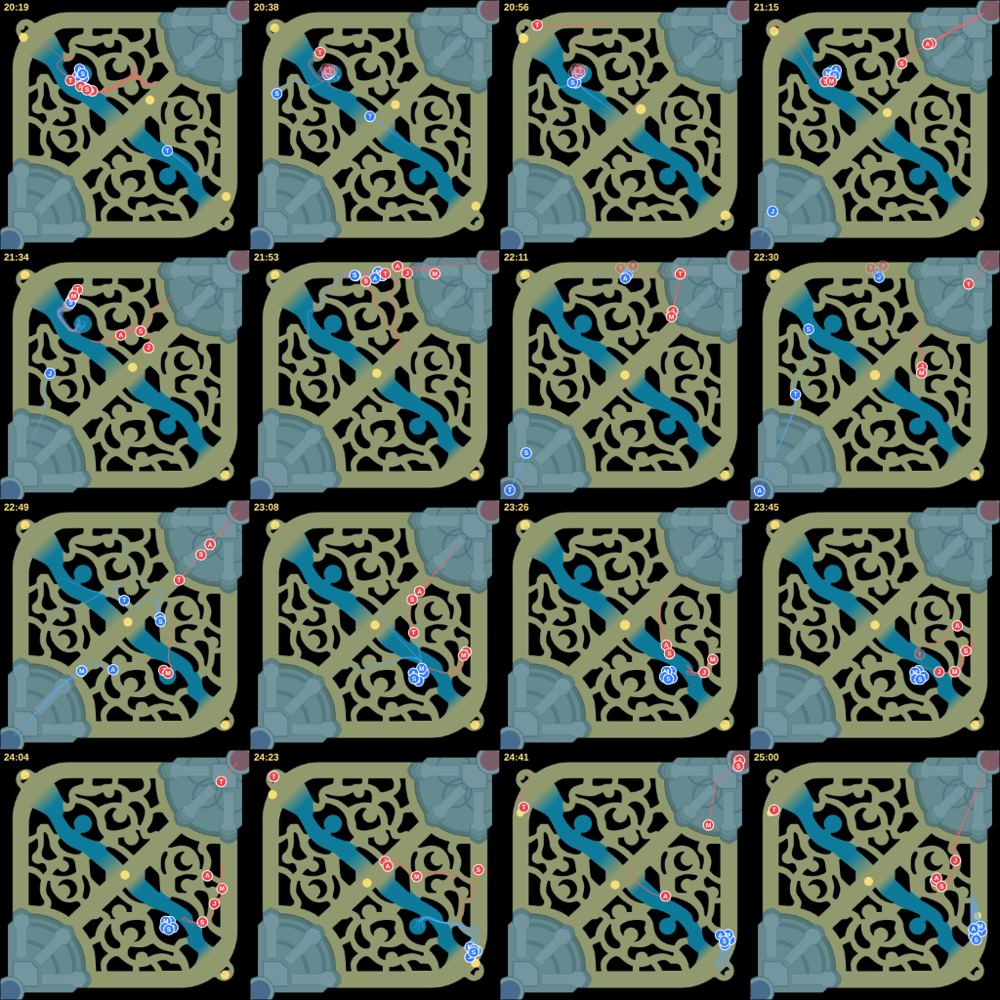

# 선수 이동 시스템 (미니맵 움직임 새로 만들기)

경기 결과 계산(교전·오브젝트·골드·포탑)은 그대로 두고, **위치와 이동을 만드는 부분만** 새로 만들었다.

## 왜 바꿨나 (바꾸기 전)
- 이동은 "5초마다 목표 쪽으로 직선으로 최대 거리만큼"이었다. 벽 개념이 없어 정글 벽·강 언덕을 가로질렀다.
- 화면은 5초 틱 위치 사이를 CSS transition(직선)으로 이었다. 꺾이는 길도 직선으로 미끄러졌다.
- 같은 임무의 선수는 같은 점(±약간)으로 가서 4~5명이 한 점에 겹쳤다.
- 라인전·정글 동선·와드·대형 같은 포지션별 움직임이 없었다. 목표에 도착하면 그대로 서 있었다.

## 새 구조: 4층
| 층 | 파일 | 하는 일 |
|---|---|---|
| 1) 팀 운영 | `js/engine/teamai.js` | (기존) 팀 계획과 선수별 임무(`p.task`: lane·camp·gank·objSetup·siege…) |
| 2) 포지션별 행동 | `js/engine/behavior.js` `goalFor` | 임무 → 지금 1초 동안 갈 "목표 점"과 속도 성격 |
| 3) 길찾기 | `js/engine/nav.js` | 이동 그래프 A* → 직선 당기기 → Catmull-Rom 곡선 (벽 검사) |
| 4) 조향 | `js/engine/behavior.js` `steer` | 가속·도착 감속·회전 제한·팀원 밀어내기, 1초 이동 |

- 엔진 틱은 5초 그대로다. `teamai.js` `movement()`가 한 틱 안에서 **1초씩 5번** 조향하고, 1초 위치를 `g.secLog`에 남긴다.
- 화면(`js/ui/matchScreen.js`)은 `g.secLog`의 1초 점 사이를 `requestAnimationFrame`으로 매 프레임 보간한다. 화면이 위치를 만들지는 않는다.
  - 1초에 0.05 넘게 옮겨진 구간(귀환·순간이동·부활)은 미끄러지지 않고 바로 옮긴다.
- 교전·오브젝트·포탑 판정은 이전처럼 틱 끝에 "그 자리에 실제로 있는 선수"로 한다(계획 → 이동 → 도착 → 판정).

### 맵 이동 그래프 (`data/navgraph.js`, `tools/build-navgraph.mjs`)
- 걸을 수 있는 곳은 실제 미니맵 이미지(ddragon `map11.png`)의 밝기로 정한다(밝기 45 초과 = 길).
  - 256×256 격자로 줄여 RLE로 저장(`MASK`). 벽까지 거리(칸)도 계산한다.
- 노드 1,029개, 간선 5,434개, 하나로 이어짐.
  - 이름 있는 노드 237개: 본진 6, 본진 출구 6, 포탑 18, 캠프 입구 12, 둥지 2, 둥지 입구 8, 강 26, 부쉬 27, 시야 지점 11, 라인 121.
  - 나머지는 통로 노드 792개다. 벽에서 3칸 이상 떨어진 곳은 0.034 간격, 바위 옆 같은 좁은 통로는 2칸 이상에 0.02 간격.
- 간선은 0.075 안에서, 벽에서 1칸 이상 떨어진 직선만 잇는다.
- 길찾기 순서
  1. 직선으로 갈 수 있으면 바로 간다.
  2. 아니면 A*로 찾는다. 지금 가던 방향 뒤쪽 시작 노드에는 비용을 더한다.
  3. 보이는 가장 먼 점으로 직선을 당긴다(벽 2칸 여유).
  4. Catmull-Rom으로 꺾이는 곳을 둥글게 한다. 곡선 조각이 벽에 닿으면 그 구간은 직선으로 둔다.
- 디버그 모드에서 미니맵 위에 그래프(노드 종류별 색, 간선)를 겹쳐 그린다.

### 포지션별 행동 (`goalFor`)
- **미니언 웨이브** (`world.js` `waveSize`)
  - 웨이브마다 위치(기존 `g.waves[l].s`)와 크기(`n: [블루, 레드]`)가 있다.
  - 30초마다 6마리씩 생기고, 밀리는 쪽이 더 많이 잃고, 포탑 앞에서 녹는다. 그래서 쌓이고 밀린다.
  - 화면은 크기만큼 점을 늘어놓는다(2마리당 1점, 최대 10점).
- **라인전**
  - 라이너는 웨이브 바로 뒤에 선다. 웨이브가 밀면 따라가고, 당겨지면 물러난다.
  - 1~3초마다 반경 0.008 안에서 막타 치듯 작게 움찔한다(느린 속도).
  - 70~110초마다 가까운 부쉬·강가(0.11 안)로 와드를 박으러 갔다가 4초 머문 뒤 돌아온다. 적이 가깝거나 체력이 낮으면 가지 않는다.
  - 귀환은 기존 규칙(체력·골드)을 따른다. 8초 채널링 동안 멈춰 있다가 본진으로 옮긴다.
- **정글**
  - 기존 캠프 순서를 따라 실제 길로 이동한다.
  - 캠프마다 정리 시간(`campClear`: 블루·레드 15초, 칼날부리·늑대·두꺼비 8초, 돌거북 10초) 동안 캠프 둘레를 천천히 돈다.
  - 갱킹은 대상 근처의 부쉬·강 노드를 거쳐 돌아 들어간다. 한 번 덮쳤으면 같은 갱 동안 다시 부쉬로 돌아가지 않는다.
- **서폿**
  - 원딜 위치를 부드럽게 따라가며(0.12씩) 원딜보다 살짝 뒤·옆에 선다. 원딜과 같은 쪽에만 서고, 바위 너머로는 가지 않는다.
  - 오브젝트 등장 55초 전에는 강·정글 입구 시야 지점으로 와드를 박으러 간다.
- **탑**: 사이드 운영 임무 동안 사이드에 오래 머문다. 텔레포트는 채널링 동안 멈춰 있다가 도착지(걸을 수 있는 곳으로 맞춤)에 나타난다.
- **무리 이동 대형** (group·siege·defend·nexus·objSetup·objContest·side, 같은 임무 3명 이상)
  - 탱커·이니시 2명은 앞, 원딜은 뒤, 서폿은 뒤 옆, 미드·정글은 양옆에 선다.
  - 대형은 이동 방향으로 돌린다. 0.15 안에 적 무리가 있으면 적 쪽으로 돌린다.
  - 이동 중에는 넓게(앞 0.034·뒤 0.03·옆 0.03), 도착하면(공성·대기) 0.62배로 좁힌다. 간격은 천천히 바뀐다.
  - 자리가 벽 너머면 무리 중심에서 직선으로 갈 수 있는 데까지만 간다.
- **교전**
  - 앞라인은 교전 중심 바로 앞, 브루저는 그 뒤, 원딜·서폿·메이지는 맨 뒤에서 1초마다 앞뒤로 카이팅한다.
  - 암살자·스커미셔는 옆으로 돌아 적 후열로 들어간다.
  - 진 쪽은 흩어져 기지 쪽으로 도망간다. 죽음은 교전 판정과 같은 시각이다.
- **오브젝트**
  - 시야 장악(서폿 와드) → 둥지 입구 대치(기존 강가 장악 objSetup) → 처치를 거친다.
  - 처치 중에는 둥지 안을 천천히 돈다. 적이 오는 쪽에 앞라인, 반대쪽에 원거리가 선다.
- **멈춤**: 목표에 도착해도 아주 작게 움직인다(반경 0.004). 완전히 멈추는 건 귀환 채널링, 텔레포트 채널링, 전령 소환, 죽음뿐이다.

### 조향 (`steer`)
- 최대 속도는 챔피언 기본 이동 속도와 신발(기존 `speedMult`)로 정하고, 1초 이동 거리의 상한이 된다.
- 가속은 1초에 최대 속도의 0.9까지다. 도착점 0.025 안에서는 줄어든다(arrive).
- 회전은 1초에 110°까지다. 교전 카이팅과 도주만 예외다.
- 팀원끼리 0.014 안이면 서로 밀어낸다. 힘은 상한이 있고 부드럽게 바뀐다.
- 목표가 바뀌어도 순간 이동하지 않는다.
  - 목표가 조금(0.004~0.06) 옮겨지면 경로는 그대로 두고 끝점만 바꾼다.
  - 많이 바뀌면 지금 위치에서 다시 찾는다.
- 경로를 따라가는 규칙
  - 앞쪽 점을 향해 곧장 가기로 했으면 그 앞의 점은 버린다.
  - 다음 점이 안 보이는 모퉁이 점은 지나치지 않는다.
  - 다음 점이 안 보이면 가던 방향을 살려 바로 다시 찾는다.
- 가까운 목표(0.04 안)가 바위 반대편으로 살짝 옮겨지면 최대 3초 동안 원래 목표를 유지한다. 작은 바위 양쪽을 번갈아 돌지 않게 하기 위해서다.

## 자연스러움 검사
### 수치 검사 (`tools/validate-match.mjs`, 위반이면 실패)
| 번호 | 항목 | 기준 | 결과(500판) |
|---|---|---|---|
| 12 | 벽 통과 | 1초 위치가 벽 안이거나 1초 구간이 벽을 지나면 위반 | **0건** |
| 13 | 초당 이동 한도 | 1초 이동이 최대 속도(신발·버프 포함)를 넘으면 위반 | **0건** |
| 14 | 방향 반복 전환 | 교전·도주 밖에서 5초 안에 150° 넘게 3번 이상 뒤집으면 위반 | **0건** |
| — | 라이너 ↔ 자기 웨이브 거리 | 라인전(1:30~14:00) 평균 0.01~0.06 | **0.042** (10%/90% 0.029/0.060) |

- 1초 이동 검사 940만 회(500판).
- 기존 검사(위치·사망·오브젝트·구조물·한타 표기·운영·장면·문자중계)도 모두 0건이다.

### 연속 컷 시트 (`tools/render-minimap.mjs`)
- 같은 시드(8)로 이전 엔진과 새 엔진을 각각 돌려 0~3분·8~12분·20~25분을 16컷씩 4×4 시트로 묶었다.
- 점은 웨이브, 빨간 원은 교전, 선은 최근 20초 궤적이다. 궤적은 귀환·순간이동에서 끊었다.

| 구간 | 바꾸기 전 | 바꾼 후 |
|---|---|---|
| 0~3분 |  |  |
| 8~12분 |  |  |
| 20~25분 |  |  |

### 기준별 판정 (시트 + 측정)
1. **라이너가 웨이브와 함께 움직인다 — 충족.**
   - 8~12분 시트에서 탑·미드·바텀이 각자 웨이브 점 바로 뒤에 있다. 웨이브가 밀리면 같이 올라가고 당겨지면 같이 내려간다.
   - 라이너–웨이브 평균 거리는 0.042다. 와드 이동·귀환 뒤 복귀 같은 예외는 빼고 잰다.
2. **정글러가 캠프를 돌며 각 캠프에서 잠깐 멈춘다 — 충족.**
   - 0~3분 시트에서 J 궤적이 벽 사이 통로를 따라 캠프에서 캠프로 굽어 간다. 캠프 앞에서는 작은 고리를 그린다(정리 시간 동안 둘레 돌기).
   - 바꾸기 전에는 캠프 사이를 직선으로 건넜고 캠프에서 그대로 서 있었다.
3. **벽 통과·맵 밖 이탈 없음 — 충족.**
   - 검사 12번 0건이다. 시트의 궤적이 모두 밝은 길 위에 있다.
   - 같은 기준(새 벽 격자)으로 이전 엔진을 재면 이동 구간의 17.3%가 벽을 지났고 위치의 11.1%가 벽 안이었다.
4. **지그재그 떨림·왔다 갔다 없음 — 충족.**
   - 검사 14번 0건이다. 처음 구현했을 때는 697건이었다. 원인과 고친 내용:
     - 경로 점을 비껴 지나치면 그 점에 붙잡혀 앞뒤로 흔들렸다.
     - 보이던 앞점과 안 보이던 뒷점을 번갈아 목표로 삼았다.
     - 대형 자리가 벽 너머로 잡혀 양쪽을 오갔다.
     - 리스폰 직후 겹친 선수끼리 밀어내기 힘이 너무 컸다.
     - 서폿이 원딜의 움찔까지 따라 했다.
     - 갱 우회 지점을 틱마다 새로 골랐다.
     - 봇 라인 모퉁이 바위 양쪽으로 길이 갈렸다.
   - 이 원인들을 하나씩 고쳐 0건이 됐다.
5. **무리 이동 때 대형이 보인다 — 충족.**
   - 20~25분 시트에서 블루 5명이 한 점에 겹치지 않고 앞·뒤·옆으로 벌어져 이동한다(21:15, 21:34, 23:26).
   - 바꾸기 전 시트는 같은 장면에서 4~5명이 한 점에 겹친 채 직선으로 미끄러진다(20:19, 21:15, 23:45).
   - 팀원 겹침(0.006 안) 비율: 이전 2.6% → 0.4%.
   - 무리 임무 중 팀원 사이 평균 간격은 0.082다.
6. **교전에서 앞라인·뒷라인이 구분된다 — 충족(수치로 확인).**
   - 교전 판정 순간 위치를 "우리 무리 중심 → 상대 무리 중심" 방향으로 재면 앞라인(탱커·이니시)은 +0.0063 앞, 원딜은 −0.0064 뒤다. 120판, 교전 참가 6,000명 기준이다.
   - 처음엔 둘 다 0이었다. 교전은 한 틱 안에서 생기고 끝나서, 교전 직전 대형이 곧 교전 모양이 된다.
   - 그래서 대형과 둥지 안 자리를 적 쪽 기준으로 돌렸다. 앞라인이 적 쪽, 원거리가 반대쪽에 선다.
   - 미니맵 한 컷에서는 간격이 작아(약 5px) 눈으로는 약하게 보인다.

## 바꾸기 전 → 바꾼 후 (같은 경기 60판, 새 벽 격자로 측정)
| 항목 | 바꾸기 전 | 바꾼 후 |
|---|---|---|
| 위치 갱신 | 5초 | 1초 (화면은 매 프레임 보간) |
| 벽을 지나는 이동 구간 | 17.3% | 0% |
| 벽 안 위치 | 11.1% | 0% |
| 팀원 겹침 (0.006 안) | 2.6% | 0.4% |
| 라이너–웨이브 거리 중앙값 | 0.039 | 0.042 |
| 미니언 웨이브 | 위치만 (점 4개 고정) | 위치 + 크기 (쌓이면 길어짐) |
| 도착 후 | 정지 | 움찔·와드·캠프 돌기·둥지 돌기 |

## 결과 계산 쪽 영향과 다시 맞춘 값
- 교전·오브젝트·골드 공식은 바꾸지 않았다. 다만 선수가 실제 길로 다니니 도착 시각과 모이는 모양이 바뀌었고, 결과 분포가 움직여 수치를 다시 맞췄다.
- **이동 속도 0.0275 → 0.030**: 실제 길은 직선보다 평균 1.10배(중앙값 1.08, 90% 1.23) 길다. 직선 시절 값 그대로면 합류·수비가 늦어져 경기가 길어졌다.
- **공성 대형**: 공성·넥서스 임무 중 대형 자리를 구조물 사거리(0.05)의 85% 안으로 당긴다.
  - 넓은 대형 때문에 뒷줄이 사거리 밖으로 밀려, 사거리 안 공성 인원이 이전 45.3%에서 39.1%로 줄었다. 비슷한 팀끼리는 경기가 늘어졌다(시즌 시뮬 34.9분).
  - 고친 뒤 58.1%다.
- 바꾼 판정 하나: 장로를 치는 팀에게 견제 팀이 들어가는 교전은 견제 팀이 4명(살아 있는 인원이 적으면 전원) 둥지 근처에 모였을 때만 생긴다(`engage.objTakingMin`).
  - 먼저 온 2~3명이 1:5로 잘리는 소규모 교전이 장로 한타를 대신하던 문제를 고쳤다.
- 다시 맞춘 값
  - 드래곤 정면 성향 2.6 → 3.8, 바론 1.0 → 1.4.
  - 큰 교전 양쪽 동시 후퇴 0.38 → 0.18.
  - 기본 피해 0.045 → 0.046, 개인 도주 체력 0.28 → 0.25, 도주자 잡힐 확률 0.2 → 0.17.
  - 챔피언 구조물 피해 0.0075 → 0.0085, 외곽 포탑 방패 14분 → 12분.
  - 바론 공성 +15% → +4%, 바론 미니언 ×1.4 → ×1.1, 바론 강화 미니언 파밍 ×1.12 → ×1.08, 상대 파밍 ×0.9 → ×1.0.
  - 바론 처치 중 견제 교전 0.15 → 0.08, 장로 0.85 → 0.7, 바론 스틸 기본 0.2 → 0.3.
  - 킬 가중치: 원딜 0.72 → 0.68, 정글 0.69 → 0.65.
  - 아군 교전 합류 거리 0.30 → 0.33.
- `node tools/validate-match.mjs 500`: 위반 0건, 결과 통과 ✓
  - 평균 33.1분, 킬 27.9.
  - 한타 분포 5.7/52.4/21.3/20.6%.
  - 킬 비율: 원딜 30.8, 미드 25.9, 정글 21.9, 탑 16.0, 서폿 5.3%.
  - 드래곤 한타 39.3%, 바론 44.5%, 장로 79.2%.
  - 첫 바론 팀 승률 77.8%. 바론 골드 격차 증가 평균 2,310, 상위 10% 4,325.
- `node tools/sim-season.mjs 5 --chain`: 목표 점검 12개 모두 ✓
  - 평균 33.9분, 킬 29.5.
  - LCK 1군 90+ 6/7/5/6/8명.
- `node tools/sim-choices.mjs`: 범위 초과 0, 우월 선택지 0. 이동이 바뀌며 경기 상황 분포가 달라져 `jgl_counter` "역갱 합류"가 98% 최선이 돼, 기본 확률을 50 → 47로 낮췄다.

## 남은 점
- 5~7킬 한타 비율(21.3%)과 정글 킬 비율(21.9%)은 목표 범위 경계 가까이에 있다.
  - 첫 바론 팀 승률은 200판 표본에서 ±3%p쯤 흔들린다(같은 200판에서 이전 엔진 80.5%, 새 엔진 76.4%).
  - 이동 쪽을 크게 바꾸면 다시 벗어날 수 있으니 `validate-match 500`으로 꼭 확인한다.
- 교전이 한 틱(5초) 안에서 판정되므로 교전 중 카이팅·다이브 동작은 짧게만 보인다.
  - 앞·뒤 구분은 주로 교전 직전 대형으로 드러난다.
